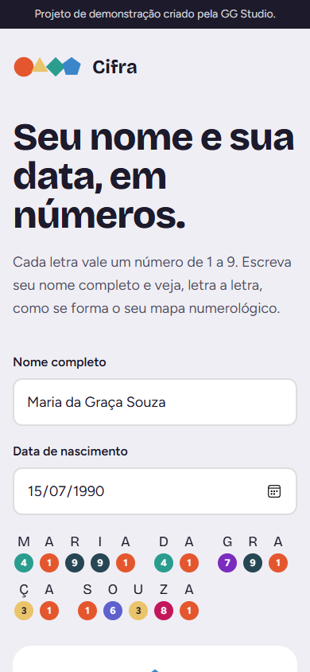

# Cifra — calculadora de mapa numerológico (demo)

Calculadora web interativa em **português do Brasil**: a partir do nome completo e da data de nascimento, calcula o mapa numerológico pelo sistema pitagórico. Projeto de portfólio da **GG Studio**.

**Ver ao vivo:** _(link da Vercel em breve)_

  
  

## O que tem

- **Cálculo ao vivo**: enquanto a pessoa escreve o nome, cada letra mostra o seu valor; o mapa aparece assim que há nome e data
- Cinco números: caminho de vida, expressão, motivação, personalidade e ano pessoal, com números mestres (11, 22, 33)
- **Identidade visual própria**: cada número de 1 a 9 tem uma cor e uma forma geométrica (círculo, triângulo, quadrado…); o mapa é composto com essas formas
- **Compartilhar resultado**: no telemóvel abre a partilha nativa (WhatsApp, Instagram…), no computador copia um link que reabre o mapa já preenchido
- Acentos e cedilha tratados corretamente (ex.: "Graça")
- Privacidade: tudo é calculado no navegador; nada é enviado nem guardado
- Lógica de cálculo com **15 testes automáticos**

## Tecnologias

Next.js (App Router) · TypeScript · Tailwind CSS · Vitest · Vercel

## Nota

Ferramenta de entretenimento; os textos interpretativos são genéricos.
